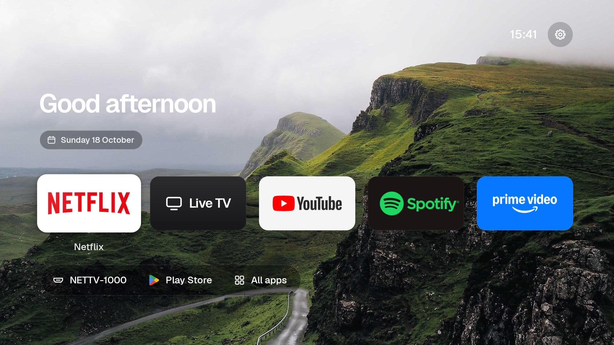
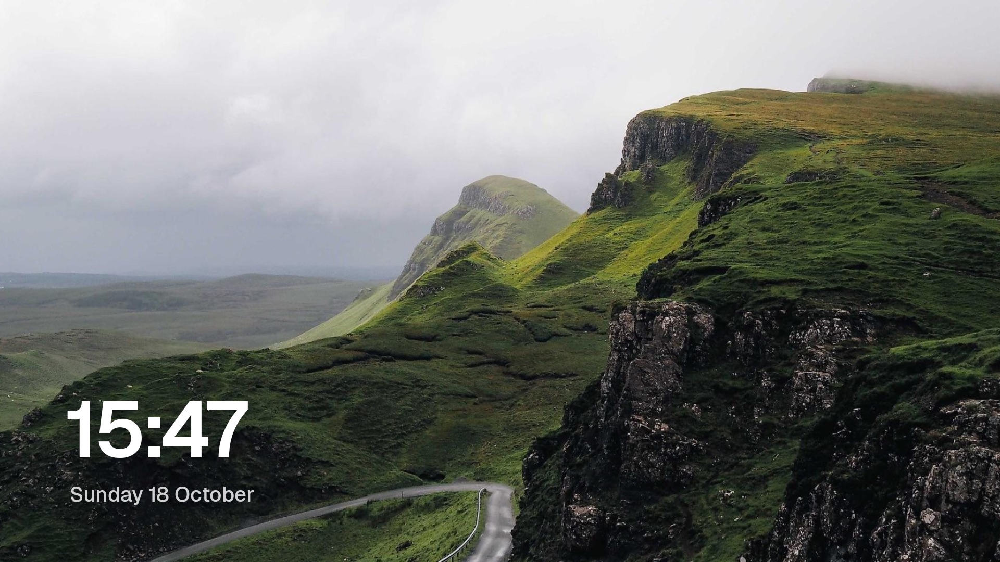

# androidtv-clean

An ad-free Android TV that feels like Apple TV. You get a home screen with no ads and no rows, a photo screensaver, a remote page for your phone, and a debloat list that switches off ads and tracking.

It all runs over ADB from your computer. No root, and every change can be undone.





Built and tested on a Sony Bravia KD-65X8000G (Android TV 9). The home screen and screensaver should work on any Android TV 8 or newer. The debloat list is written for Sony TVs, so check it against your own TV first.

## What you get

- **Home screen** (`launcher/`)
  - A photo that changes with the time of day, plus a greeting, the date, the time and the local weather.
  - Five big tiles: Live TV, Netflix, YouTube, Prime Video and Spotify. Apps that aren't installed are skipped.
  - A bar with your set-top box input, the Play Store and All apps.
  - Soft click sounds, plus Settings in the top corner.
- **Photos screensaver**: the same photos drift slowly, with a large clock.
- **Phone remote** at `http://<tv-ip>:8765`: volume, mute and the big tiles. It only answers devices on your home network.
- **Debloat** (`debloat.txt`)
  - Turns off sponsored rows, Samba TV and HbbTV tracking, telemetry, store demo and hotel mode, and unused preloaded apps.
  - Apps are switched off with `pm disable-user`, never uninstalled.

## Setup

You need:
- `adb` (`brew install android-platform-tools`).
- For building the home screen: the Android SDK command-line tools (build-tools 34, platform 34) and JDK 17 (`brew install openjdk@17`).

1. On the TV, turn on **Developer options**: Settings → Device Preferences → About, then press Build 7 times.
2. In Developer options, turn on **USB debugging**, and **Network debugging** if your TV has it.
3. Find the TV's IP address under Settings → Network.
4. Run these on your computer and accept the prompt that appears on the TV:

```sh
export TV_IP=192.168.x.x          # your TV
./backup.sh                       # save the current state to backup/ first
./disable.sh                      # debloat (read debloat.txt first)
launcher/build-and-install.sh     # build and install the home screen, then make it the default
```

Screensaver: Settings → Device Preferences → Screen saver → **Photos**.

## Make it yours

The settings are at the top of `launcher/src/com/parents/tvhome/MainActivity.java`:

- `DOCK`: the big tiles, in order. Use package names (`adb shell pm list packages`).
- `BOX_SOCKET`: the HDMI input your set-top box is on, for example `"HDMI 4"`.
- `HIDDEN`: apps never shown in All apps.

The photos are in `launcher/assets/bg/` (`morning`, `day`, `evening`, `night`, as 1920×1080 JPGs). Run `build-and-install.sh` again after any change.

## Undo

```sh
./restore.sh                      # re-enable everything, bring back the stock home screen
adb shell pm enable <package>     # bring back a single app
```

## Good to know

- **Sound through a soundbar (HDMI ARC):** if the sound cuts out in apps but menu sounds still play, the audio link has got stuck. Restart the soundbar, then the TV. On Sony TVs, keep Digital audio out on **Auto 1** for Dolby Atmos. **PCM** is the safe fallback, but it has no Atmos.
- **Remote page:** it uses plain HTTP and has no password. It only accepts devices on your local network, so don't forward port 8765 on your router.
- **Weather:** the location comes from your IP address (ipapi.co) and the forecast from Open-Meteo. No API keys are needed.

## Credits

- Font: [Geist](https://vercel.com/font) (SIL OFL, see `launcher/FONT-LICENSE-OFL.txt`).
- Photos, from [Unsplash](https://unsplash.com/license) via picsum.photos:
  - morning: [Ales Krivec](https://unsplash.com/photos/01ZeHnK3F_4)
  - day: [Andrew Ridley](https://unsplash.com/photos/Kt5hRENuotI)
  - evening: [Sebastien Gabriel](https://unsplash.com/photos/2W5LoumSdfw)
  - night: [Vashishtha Jogi](https://unsplash.com/photos/bClr95glx6k)
- App names and logos belong to their owners. This project is not affiliated with Sony, Google or Apple.

MIT licensed.
